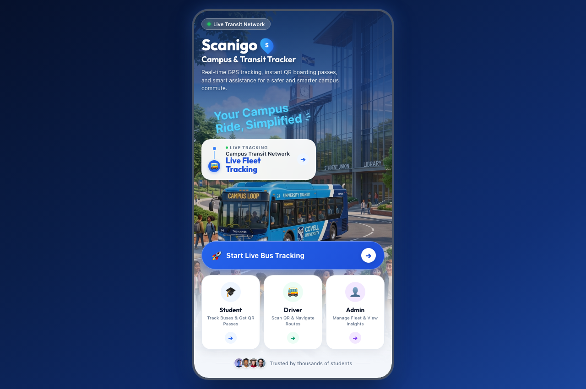
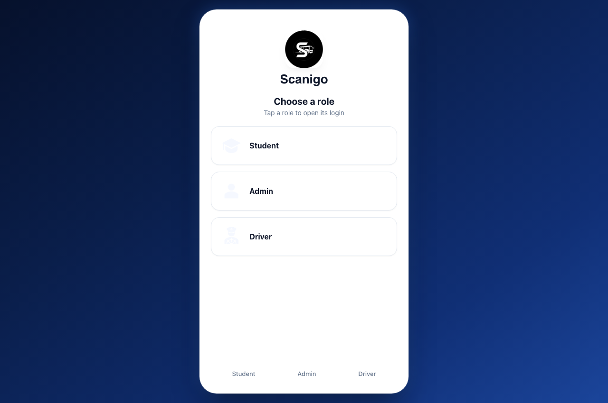
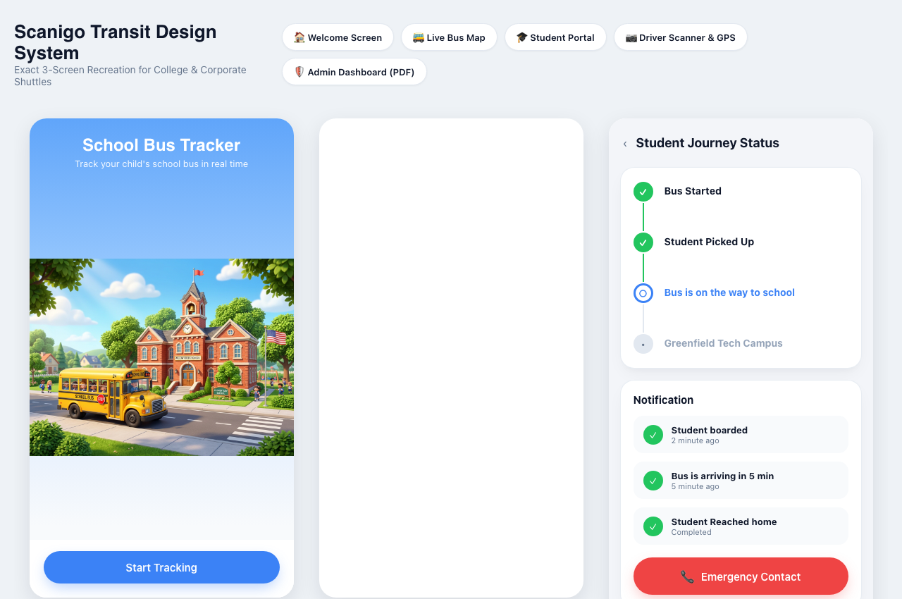
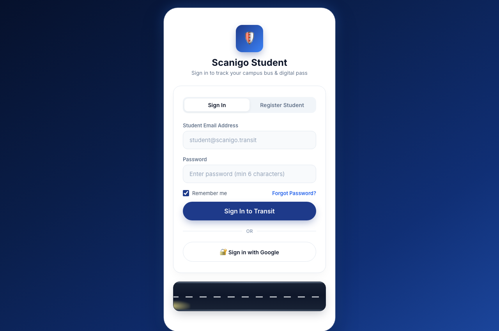
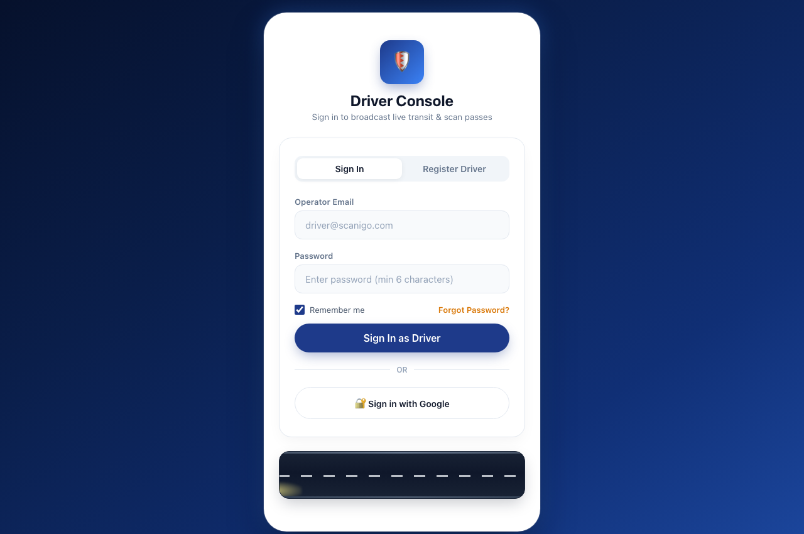
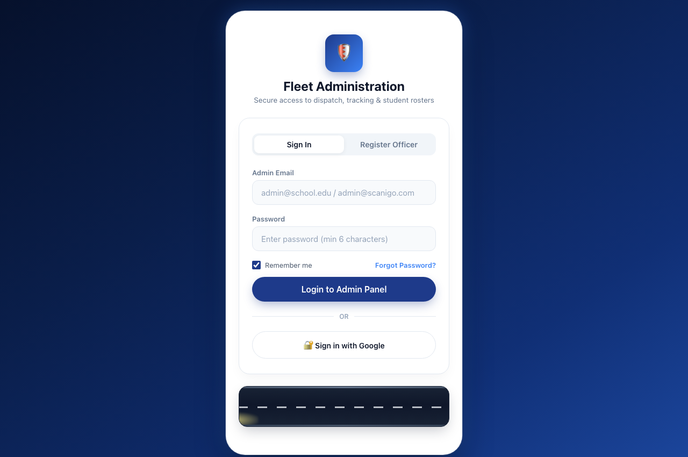
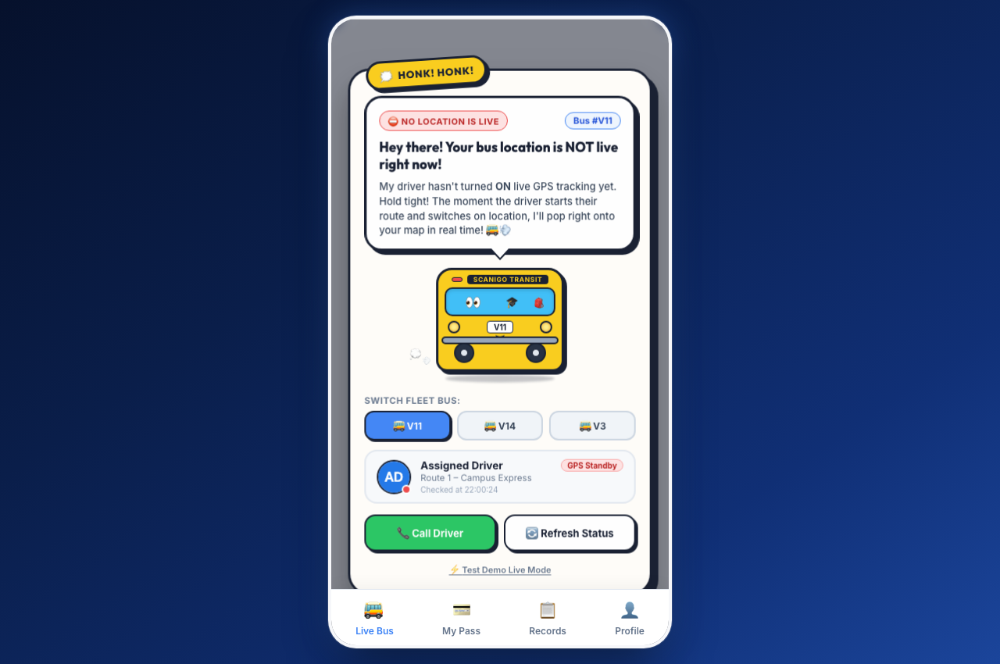
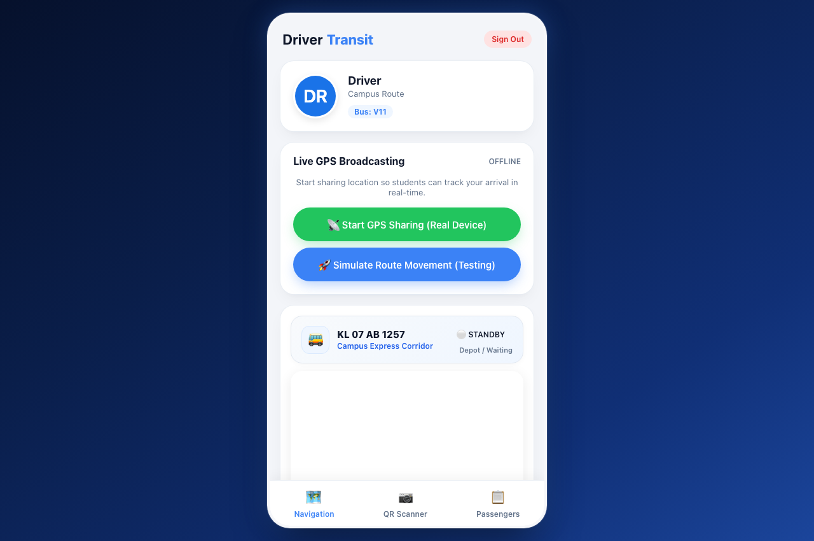
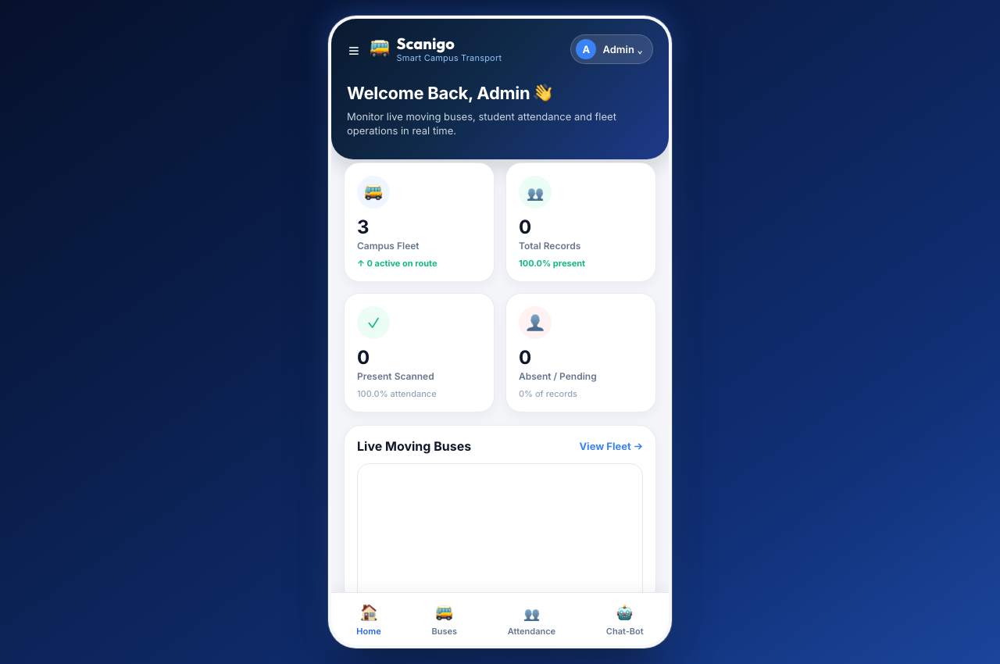
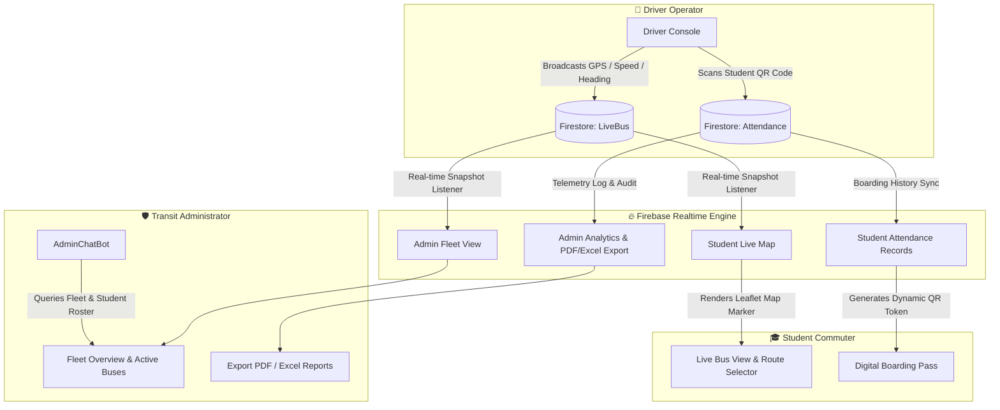

# 🚌 Scanigo — Smart Campus Transit & Real-Time Fleet Tracking Network

<p align="center">
  
</p>

<p align="center">
  <a href="https://react.dev/"></a>
  <a href="https://vite.dev/"></a>
  <a href="https://firebase.google.com/"></a>
  <a href="https://leafletjs.com/"></a>
  <a href="https://github.com/Hemal-31"></a>
  
</p>

---

## 📖 Overview

**Scanigo** is a modern, real-time campus transit tracking and fleet management ecosystem built with **React 18**, **Vite**, **Firebase Firestore**, and **Leaflet Maps**. Designed specifically for universities, schools, and corporate shuttle networks, Scanigo eliminates the uncertainty of campus transit by connecting students, drivers, and administrators into a synchronized, live-updating network.

- 🎓 **Students** can track their assigned campus bus live on an interactive map, inspect driver contacts, switch between fleet routes (e.g., V11, V14, V3), generate digital QR boarding passes, and view attendance history.
- 🚌 **Drivers** can broadcast live GPS coordinates directly from their device, simulate route movements for dry runs, scan passenger QR passes using camera-based computer vision, and monitor passenger manifests.
- 🛡️ **Administrators** have complete fleet oversight with real-time bus telemetry, student boarding verification logs, attendance report exports to **PDF** and **Excel**, and an interactive intelligent **Admin AI Assistant**.

---

## 📸 Application Screenshots

### 1. Landing & Role Entry Portals

| 🌟 Welcome & Transit Banner | 🎯 Role Selection Portal | 🚀 Transit Showcase & Timeline |
|:---:|:---:|:---:|
|  |  |  |
| *Campus backdrop with instant tracking shortcut* | *Multi-tenant role selector (Student, Driver, Admin)* | *3-Screen journey progression & notification preview* |

---

### 2. Role Authentication Consoles

| 🎓 Student Portal Login | 🚌 Driver Console Login | 🛡️ Fleet Administration Login |
|:---:|:---:|:---:|
|  |  |  |
| *Email/Password & Google Sign-In with animated road* | *Secure transit operator authentication* | *Fleet admin credentials & dispatcher access* |

---

### 3. Real-Time Dashboards & Telemetry

| 🎓 Student Live Tracking & Pass | 🚌 Driver Live GPS & QR Scanner | 🛡️ Admin Fleet Operations |
|:---:|:---:|:---:|
|  |  |  |
| *Real-time telemetry, driver contact, pass & records* | *Live GPS sharing, route simulation, QR check-in* | *Fleet metrics, active bus tracking & AI ChatBot* |

---

## ⚡ How It Works

### Architecture & Data Flow



### 1. 🎓 Student Experience
- **Live Bus Tracking**: Renders Leaflet OpenStreetMap with custom bus markers, updating position dynamically as the driver moves.
- **Route Switcher**: Seamlessly switch between campus routes (e.g., `V11`, `V14`, `V3`) to view alternate shuttles.
- **Assigned Driver Card**: View the assigned driver's name, route status, and initiate direct calls in one click.
- **Digital QR Boarding Pass**: Instant client-side QR token generation via `qrcode.react` and `html-to-image` for high-resolution pass downloads.
- **Attendance Records**: Real-time Firestore subcollection listener (`Attendance/{studentId}/records`) reflecting boarding confirmations.

### 2. 🚌 Driver Operations
- **Live GPS Sharing**: Uses HTML5 Geolocation API (`navigator.geolocation.watchPosition`) to push high-frequency coordinates to `LiveBus/{busId}`.
- **Simulation Mode**: Built-in route movement simulator allows testing and demonstrations without needing a moving vehicle.
- **Camera-Based QR Scanner**: Uses `html5-qrcode` to scan student QR boarding passes directly from the device camera.
- **Instant Check-in**: Validates student registration, stamps timestamp and bus ID, and logs attendance automatically.

### 3. 🛡️ Admin Fleet Management
- **Operational Metrics**: Displays live count of total campus buses, active routes, total boarding events, and attendance percentage.
- **Live Fleet Map**: Multi-vehicle map visualizing every moving bus on campus simultaneously.
- **Export Capabilities**:
  - 📊 **Excel**: Exports student attendance records to formatted `.xlsx` spreadsheets using `xlsx` (SheetJS).
  - 📄 **PDF**: Generates professional branded attendance reports with summary tables using `jspdf` and `jspdf-autotable`.
- **Admin ChatBot Assistant**: In-dashboard intelligent assistant (`AdminChatBot.jsx`) capable of answering questions regarding fleet status, bus routes, driver assignments, and student rosters.

---

## 🛠️ Technology Stack

| Domain | Technologies |
|:---|:---|
| **Frontend Framework** | [React 18.2](https://react.dev/), [Vite 7.2](https://vite.dev/) |
| **Routing** | [React Router v6](https://reactrouter.com/) (`HashRouter` for zero-config static hosting) |
| **Cloud & Backend** | [Firebase 12.7](https://firebase.google.com/) (Cloud Firestore Real-Time DB, Firebase Authentication) |
| **Mapping & Geospatial** | [Leaflet 1.9](https://leafletjs.com/), [React-Leaflet 4.2](https://react-leaflet.js.org/), OpenStreetMap / CartoDB Voyager Tiles |
| **QR & Computer Vision** | [html5-qrcode 2.3](https://github.com/mebjas/html5-qrcode), [qrcode.react 4.2](https://github.com/zpao/qrcode.react) |
| **Export Engines** | [jsPDF 4.2](https://github.com/parallax/jsPDF), [jspdf-autotable 5.0](https://github.com/simonbengtsson/jsPDF-AutoTable), [xlsx 0.18](https://github.com/SheetJS/sheetjs) |
| **Image & Animation** | [html-to-image 1.11](https://github.com/bubkoo/html-to-image), [Anime.js 4.5](https://animejs.com/) |

---

## 📂 Project Directory Structure

```text
Scanigo/
├── public/                     # Static assets and public images
├── screenshots/                # Application UI screenshots for documentation
│   ├── 01_welcome.png
│   ├── 02_role_selection.png
│   ├── 03_showcase.png
│   ├── 04_student_login.png
│   ├── 05_driver_login.png
│   ├── 06_admin_login.png
│   ├── 07_student_dashboard.png
│   ├── 08_driver_console.png
│   └── 09_admin_dashboard.png
├── src/
│   ├── assets/                 # Stylesheets, icons, and background graphics
│   ├── components/             # Reusable modular UI components
│   │   ├── admin/              # AdminChatBot and administrative tools
│   │   ├── common/             # MovingBusRoad and animated helpers
│   │   └── maps/               # BusTrackingView Leaflet map component
│   ├── config/                 # Firebase app initialization & service exports
│   │   └── firebase.js
│   ├── pages/                  # Route views
│   │   ├── admin/              # AdminDashboard, AdminLogin
│   │   ├── driver/             # DriverDashboard, DriverDetails, DriverLogin
│   │   ├── landing/            # TrackerWelcome, TrackerShowcase, RoleSelect
│   │   └── student/            # StudentDashboard, BusTrackingPage, StudentLogin, EnterDetails
│   ├── routes/                 # AppRoutes and ProtectedRoute authentication guard
│   ├── services/               # authService and firestoreService data layer
│   ├── utils/                  # cookieUtils, mapTiles helper configurations
│   ├── App.jsx                 # Root component
│   └── main.jsx                # React DOM entrypoint with HashRouter
├── firestore.rules             # Production Cloud Firestore Security Rules
├── index.html                  # HTML5 entrypoint
├── package.json                # Project dependencies and npm scripts
└── vite.config.js              # Vite bundler configuration
```

---

## 🚀 Getting Started & How to Run

### 1. Prerequisites
- [Node.js](https://nodejs.org/) (Version **18.0.0** or higher recommended)
- `npm` (Version **9.0.0** or higher)

### 2. Clone the Repository
```bash
git clone https://github.com/Hemal-31/Scanigo.git
cd Scanigo
```

### 3. Install Dependencies
```bash
npm install
```

### 4. Firebase Configuration
The project is configured out-of-the-box in `src/config/firebase.js`. If you wish to connect your own Firebase project:
1. Go to the [Firebase Console](https://console.firebase.google.com/) and create a project.
2. Enable **Authentication** (Email/Password and Google Provider).
3. Create a **Cloud Firestore** database.
4. Replace the credentials in `src/config/firebase.js`:
```javascript
const firebaseConfig = {
  apiKey: "YOUR_API_KEY",
  authDomain: "YOUR_PROJECT_ID.firebaseapp.com",
  projectId: "YOUR_PROJECT_ID",
  storageBucket: "YOUR_PROJECT_ID.firebasestorage.app",
  messagingSenderId: "YOUR_SENDER_ID",
  appId: "YOUR_APP_ID"
};
```

### 5. Start the Development Server
```bash
npm run dev
```
Open your browser and navigate to:
```text
http://localhost:5173
```

### 6. Build for Production
To create an optimized production build:
```bash
npm run build
```
To preview the production bundle locally:
```bash
npm run preview
```

---

## 🧪 Testing & Demo Workflows

Want to test the app without having physical buses running? Scanigo includes built-in simulator features:

1. **Student Live Tracking Demo**:
   - Open the **Student Portal** (`/#/student-login`) or navigate to `/#/student-dashboard`.
   - On the Live Bus tab, click **⚡ Test Demo Live Mode** to simulate the assigned bus driving along the route in real-time.
2. **Driver GPS Broadcasting & Simulation**:
   - Log into the **Driver Console** (`/#/driver-login`).
   - Click **🚀 Simulate Route Movement (Testing)** to broadcast continuous GPS telemetry to Firebase without moving.
   - Open the Student or Admin dashboard in another window to observe real-time map updates!
3. **Boarding & QR Scanning**:
   - In Student Dashboard, switch to the **My Pass** tab to reveal the dynamic QR pass.
   - In Driver Console, switch to the **QR Scanner** tab to scan the pass using your webcam or mobile camera.
   - Check the **Records** tab on the student side or the **Attendance** tab on the admin dashboard to verify instantaneous check-in.

---

## 🔒 Firestore Security Rules

The repository includes a ready-to-deploy [`firestore.rules`](./firestore.rules) file supporting:
- `Students`: Profiles, assigned bus numbers, and QR pass metadata.
- `Drivers`: Driver profiles and assigned route allocations.
- `Admins`: Fleet administrators and dispatch managers.
- `LiveBus`: High-frequency real-time vehicle GPS telemetry (lat/lng, speed, heading).
- `Attendance`: Student boarding records with subcollection logging (`Attendance/{studentId}/records/{recordId}`).
- `ScanHistory`: Unified scanner audit logs for fleet analytics.

Deploy rules via Firebase CLI:
```bash
firebase deploy --only firestore:rules
```

---

## 👤 Author

Developed by **Hemal Ramm**  
- **GitHub**: [@Hemal-31](https://github.com/Hemal-31)  
- **Email**: [hemalramm2016@gmail.com](mailto:hemalramm2016@gmail.com)

---

## 📄 License

This project is licensed under the [MIT License](LICENSE).
