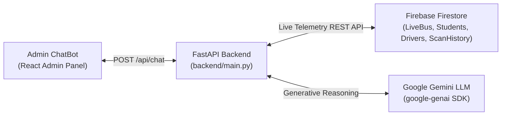

# 🚀 ScaniGo Agentic AI Backend (FastAPI + Google Gemini + Live Firestore)

This service replaces the offline Ollama prototype with an **Agentic RAG Engine** powered by **Google Gemini** and connected directly to **Firebase Firestore** (`scanigo-a9302`).

---

## 🛠️ System Architecture



1. **Live Firestore Integration** ([backend/services/firestore_service.py](file:///Users/apple/Desktop/React-scan/Scanigo/backend/services/firestore_service.py)):
   - Directly queries `LiveBus`, `Students`, `Drivers`, and `ScanHistory`.
   - Computes live attendance percentages, active bus counts, and student manifests on-the-fly.
2. **Gemini Agentic RAG Controller** ([backend/services/gemini_agent.py](file:///Users/apple/Desktop/React-scan/Scanigo/backend/services/gemini_agent.py)):
   - Ingests real-time fleet context into structured prompts.
   - Generates contextual answers with markdown formatting, speed metrics, timestamps, and actionable suggestions.
   - Includes graceful client-safe fallback if the API key is not yet set.
3. **Admin Panel ChatBot UI** ([src/components/admin/AdminChatBot.jsx](file:///Users/apple/Desktop/React-scan/Scanigo/src/components/admin/AdminChatBot.jsx)):
   - Calls `http://localhost:8000/api/chat` with automatic fallback to client-side state.

---

## ⚡ Quick Start

### 1. Configure Gemini API Key
Open [backend/.env](file:///Users/apple/Desktop/React-scan/Scanigo/backend/.env) and paste your Google Gemini API key:
```env
GEMINI_API_KEY=your_actual_gemini_api_key_here
FIREBASE_PROJECT_ID=scanigo-a9302
PORT=8000
```
> *(Get a free Gemini API Key at [Google AI Studio](https://aistudio.google.com/))*

### 2. Start the Backend Server
```bash
cd backend
./start.sh
# OR: python3 main.py
```
The server will start on: **`http://localhost:8000`**
API Docs: **`http://localhost:8000/docs`**

### 3. Start the Frontend
In the root directory:
```bash
npm run dev
```
Open the Admin Dashboard, click the **AI ChatBot** floating button, and ask questions!
